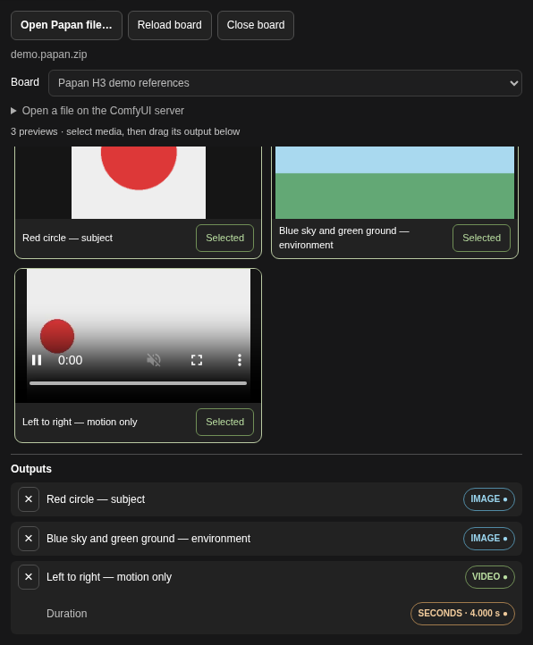

# Papan for ComfyUI

Connect [Papan](https://github.com/chelij/papan) to **one Papan Board node** and browse the collections you choose to share. Changes appear automatically. Select media to add IMAGE or VIDEO outputs below the gallery. Extracted poses appear beside their source video and can be selected as separate VIDEO references.

Live connections unlock protected collections in Papan. You can also open saved `.papan` files and portable exports; protected files show a password popup.

Live connections require **Papan v0.3.2 or newer** and **this extension v0.1.4 or newer**, using Papan's local library protocol v1. Older extension versions continue reading saved files.

[Download ZIP](https://github.com/chelij/comfyui-papan/releases/latest) · [Papan](https://github.com/chelij/papan) · [Report an issue](https://github.com/chelij/comfyui-papan/issues) · [Ecosystem and compatibility](https://github.com/chelij/papan/blob/main/docs/ecosystem.md)



## Install

Requires Python 3.11+ and a recent ComfyUI with native VIDEO support. Live connections require Papan on the same computer as the **ComfyUI server**. Saved `.papan` or `.papan.zip` files work independently. Verified on Linux with ComfyUI 0.37.0 / frontend 1.53.6 and ComfyUI Desktop's ComfyUI 0.39.2 / frontend 1.53.10, including Nodes 2.0. ComfyUI provides Pillow, PyAV, and aiohttp; this extension also uses `cryptography` for protected files.

### Git

Clone this repository into the **active installation's** `custom_nodes` folder:

```sh
cd /path/to/ComfyUI
git clone https://github.com/chelij/comfyui-papan.git custom_nodes/comfyui-papan
```

Install the requirement with **the Python that runs that ComfyUI installation**. For a Linux installation with a `.venv`:

```sh
.venv/bin/python -m pip install -r custom_nodes/comfyui-papan/requirements.txt
```

For Windows portable, from `ComfyUI_windows_portable`:

```powershell
git clone https://github.com/chelij/comfyui-papan.git ComfyUI/custom_nodes/comfyui-papan
python_embeded\python.exe -m pip install -r ComfyUI/custom_nodes/comfyui-papan/requirements.txt
```

Restart ComfyUI and refresh its window. Add **Papan → Papan Board**.

### ZIP

Download the extension ZIP from [Releases](https://github.com/chelij/comfyui-papan/releases/latest) and extract it into `ComfyUI/custom_nodes/`. The resulting folder must be `custom_nodes/comfyui-papan/`, with `__init__.py` directly inside it. Install the requirement and restart as above.

For ComfyUI Desktop, use the installation folder belonging to the instance you launch. A separate ComfyUI checkout can have a different `custom_nodes` folder. Install only one copy of the extension. To replace an existing ZIP installation, back up its extension folder and replace it with the new release; leave ComfyUI's input files and workflows in place.

### Update a Git installation

```sh
git -C /path/to/ComfyUI/custom_nodes/comfyui-papan pull --ff-only
```

Install requirements with ComfyUI's Python again if they changed, then restart ComfyUI and refresh its window.

## Connect Papan

1. In Papan, open **Connect apps**, enable connections, enter **ComfyUI** as the app name, and select its collections. Unlock a protected collection before granting it.
2. Create the app key and copy the connection. Keep Papan open.
3. In ComfyUI, add **Papan → Papan Board** and click **Connect Papan…**. Paste the copied connection and click **Connect**.
4. Choose a collection and click **Open collection**. Select references and connect their outputs as described below.

The ComfyUI backend talks to Papan at an explicitly configured IPv4 loopback address. The browser can run elsewhere, but Papan and the ComfyUI server must share a computer. The extension does not search for libraries or contact source websites. Only collections granted to this app appear.

Papan's change notifications refresh opened boards after edits, downloads, pose extraction, locking and access changes. **Refresh board** also refreshes manually. A disconnected service retries automatically. Locked collections show **Unlock this collection in Papan**; no collection password or vault key is sent to ComfyUI. Locking, removing access or revoking a key stops further reading and playback. Existing output slots and wires stay in place when references disappear, with unavailable outputs disabled.

**Connect Papan…** also lists saved connections. Use **Update connection** with a newly copied key or changed port to retain workflow identities for the same Papan library. A different library requires a separate connection. **Disconnect** removes that connection's stored credential from this ComfyUI server. Revoke it in Papan to invalidate it everywhere. If a key is revoked, reconnect with a new key; ordinary service interruptions reconnect automatically.

The app key is stored only in `papan/connections.json` under ComfyUI's configured **user directory**, using atomic writes and owner-only file permissions on POSIX systems. It is never returned in connection listings, placed in media URLs, or saved in workflow JSON. Treat this server settings file as a credential; do not share it with workflows. Up to four browser tabs can subscribe with the same Papan app key. Multiple nodes in one tab share one subscription.

Live workflows store connection/collection/pin/item identities and preview metadata. Reopening a workflow on the same ComfyUI server reuses its stored connection. Each Papan library has one saved connection on that server. Reconnecting after **Disconnect**, or pasting its connection on another ComfyUI server, restores the same library identity and workflow outputs. The Papan library still needs to be reachable on that server's computer. Every run rechecks current grants and fetches connected media, including when ComfyUI already cached an earlier result. Live workflows retain their output mappings when the service is unavailable and do not silently switch to old imported copies.

## Open a saved board

Add **Papan → Papan Board** from ComfyUI's node menu, then click **Open Papan file…** on the node. Choose a saved `.papan` list, encrypted `.papan` file, or portable `.papan.zip` export. Protected files show a password popup; an incorrect password lets you retry or cancel.

You can open several boards and switch between them. For large files already on the server, expand **Open a file on the ComfyUI server** and enter the full file path. This also avoids uploading another copy. The extension never searches for Papan libraries or uses environment variables to discover them.

Ordinary `.papan` lists reference saved media by absolute path. Those files must be accessible to the **ComfyUI server**, even when the list is selected in a browser on another machine. Portable `.papan.zip` and encrypted `.papan` files include their media and work across machines. Uploads are limited to 512 MiB; use the server file path for larger boards. Each media file is limited to 512 MiB, matching Papan.

Opening a file loads a snapshot. Click **Reload board** to refresh a file opened by server path; choose an updated local file again to refresh an upload. No running Papan process or account is required.

## Connect references

1. Connect a collection or open a file on the node. All previews appear automatically in the scrollable gallery, including previews beyond the first page. Live connections support up to 50,000 pins.
2. Click a pin to highlight it; videos play muted and looping without adding an output. Video duration appears in seconds beside **Select** as the pin comes into view. Click **Select** to add its title and **IMAGE ●** or **VIDEO ●** connector in **Outputs**, below the scrolling gallery.
3. Drag an output connector to a compatible input. Select several media items from the same node as separate references. Output rows stay visible while you scroll; the node grows to fit them.
4. Run the workflow. Only connected media is imported at full resolution. Live video previews stream through the ComfyUI server without creating input copies. Playing a video from a saved file copies that clip for playback.

Drag the node's corner to resize the gallery and its individual previews. Increasing either width or height enlarges the previews. Mouse-wheel scrolling over the previews scrolls the gallery, including when the pointer is over a video. Your chosen node size is retained when selecting references and saving workflows; selecting more outputs grows the node only when they need extra space.

Wires start at the dots on the right of the IMAGE, VIDEO, and SECONDS buttons and stay aligned when you change references or boards. Papan's wires appear above preview panels, including while dragging and when using H3's multiple-reference connections. The wire layer lets clicks and scrolling pass through to the node.

Each selected video also has a **SECONDS ●** output (FLOAT), showing its duration once the preview loads or the workflow runs. Drag it to a video generator's duration input, such as the socket beside H3 Easy's **Seconds** widget. The value comes from the same clip as the VIDEO output, including when SECONDS is the only connected output. It keeps fractional seconds; the downstream model's duration limits and frame rounding still apply.

Click its **Selected** button to deselect it, stop playback, and remove its media/duration outputs and connections. **×** on an output does the same. Clicking a selected pin keeps its outputs and connections. Other references keep their output indices.

You can open several live collections or saved files in one node and switch boards. Selected output titles remain below the gallery across board switches and workflow reloads. Previews removed from the source board keep existing connected outputs so a saved reference is not silently rewired. Files saved by Papan represent individual boards.

MiniMax H3 Easy accepts multiple image/video connections through its Media input. Use H3's index reference mode (`<Picture 1>`, `<Video 1>`, etc.) to distinguish references from the same board node. The downstream model's reference limits still apply.

If Papan has extracted a video's pose, its card shows **Pose available** and **Select pose**. Click **Select pose** to add **title · pose** with native VIDEO and SECONDS outputs. Connect the pose's VIDEO to a compatible reference or pose-control input; it is independent of the original video and its audio. Pose attachments stay out of the regular gallery and do not autoplay. **Pose selected** or **×** removes only that pose's outputs and connections. A missing saved pose shows **Pose unavailable**; restore it in Papan or use a complete export. Live boards refresh automatically after extraction. For saved files, reload a server-path board or reopen an updated upload.

Selecting a pose supplies the skeleton video as media. Following that pose depends on the downstream model and its pose-conditioning support; this extension does not add a ControlNet model or change generation settings. Protected pose attachments follow the same unlocking and input-copy rules as their source videos.

For nodes that expect video frames as an IMAGE tensor, connect VIDEO through ComfyUI's **Get Video Components** node. The extension uses native IMAGE/VIDEO types and has no dependency on an H3 node pack.

Saved originals take priority; cached previews are used when originals are missing or unreadable. Online boards may only contain reduced previews. Still images become PNG files with orientation and transparency preserved; animated images use their first frame. Clips retain their original container, frames, timing, and audio. Missing media needs to be restored in Papan or included in a fresh portable export.

## Protected boards and workflow storage

Live collections unlock in Papan; their passwords and vault keys stay there. For saved encrypted files, passwords are sent to the ComfyUI server only for unlocking. Passwords, app keys and session tokens are never saved in workflow JSON or included in media filenames. File decryption uses Papan's existing scrypt and AES-256-GCM format. Unlocked file keys and decrypted thumbnails remain in memory; session responses disable browser caching.

**Executed references become unencrypted files under `papan/` in ComfyUI's configured input directory** (normally `ComfyUI/input/papan/`). Downstream nodes can also retain generated tensors, previews or outputs. Workflow JSON stores preview titles, board/item IDs, media kinds, pose/source relationships, source descriptors, filenames for imported file references, and duration-output mappings/display values. Metadata for protected boards is therefore visible in a saved workflow after unlocking. Already delivered input files remain on disk after locking, closing, or restarting; delete them when no longer needed. Saved-file workflows can keep using their imported copies. Live workflows require current Papan access on every run and never use these files as an offline fallback.

Uploaded board files are retained under `papan/boards/` in that input directory so workflows can reopen them. Protected uploads stay encrypted. Plain boards reopen automatically; protected boards show **Unlock board** after a reload. Save/copy these board and media input files alongside a workflow when moving it to another machine. Ordinary board lists still require their referenced media paths to be accessible on the new server.

For saved files, use **Lock board** or **Close board** to discard the node's session. Closing removes the temporary upload, while the retained board copy and imported media remain. Server-path originals are left intact. Browse sessions expire after 30 minutes of inactivity and are discarded on subsequent access or when another file opens. If previews report an expired session, refresh or unlock the board. Live execution uses the saved server connection independently of browse sessions. Browser reloads close sessions where the browser can deliver the request. ComfyUI cleans its temporary directory on restart.

The extension makes no requests to source websites and never modifies the source board or its media. Its endpoints use ComfyUI's access arrangement. Use trusted ComfyUI access, particularly when entering passwords or opening server file paths.

## Try the included example

1. Load [`examples/Papan_References.json`](examples/Papan_References.json) in ComfyUI.
2. On its Papan Board node, click **Open Papan file…** and choose [`examples/demo.papan.zip`](examples/demo.papan.zip) from your downloaded ZIP or Git checkout.
3. Run the workflow to preview two images and the video frames. The reference connections are already wired. The video also exposes **SECONDS** for a compatible duration input.

The example uses synthetic shapes and ComfyUI's built-in preview/video nodes. It needs no model download or H3 extension. To use your own board, add a fresh Papan Board node, open your file, select references, and connect their outputs.

## Development and releases

The [v0.1.5 reliability release](https://github.com/chelij/comfyui-papan/releases/tag/v0.1.5) adds identifier/JSON validation, readable-video fallback and saved-copy cache refresh. [Changelog and previous-release diff](CHANGELOG.md). Its main checks use the immutable desktop 0.3.4 candidate; tag checks use the published desktop v0.3.4. Production frontend bytes match v0.1.4; existing Linux saved/live renderer evidence is retained after runtime comparisons. [Exact release checks and limits](https://github.com/chelij/papan/blob/main/docs/verification.md#reliability-releases-17-october-2026).

Published [v0.1.4](https://github.com/chelij/comfyui-papan/releases/tag/v0.1.4) at `442d57923ef16c41b2e93e03a0bf63bfc1520f6c` connects to [desktop v0.3.2](https://github.com/chelij/papan/releases/tag/v0.3.2) at `139edae3e5c6e64c5ee8dd0b0605ed75efdc8264` (provider SHA-256 `64978a366d948a23d41ce80681d3e249bef081fc3fc40357bdf9df71d7965399`). The [main preflight](https://github.com/chelij/comfyui-papan/actions/runs/38541356269) and [tagged release](https://github.com/chelij/comfyui-papan/actions/runs/38545311309) pass all 21 format/endpoint tests on Python 3.11 and 3.13; tagged checks use the published desktop tag. Local Python 3.12.12/3.13.12 checks and live/saved-file workflows pass in classic and Nodes 2.0 on Linux, ComfyUI 0.39.2 (`3c1b7a17`), frontend 1.53.10, using isolated CPU servers and headless Chromium. Live coverage includes 203 previews, full 51-frame pose execution, protected cached-prompt denial, both restarts, automatic updates, revocation/reconnect, stable workflow identities/wires and workflows without credentials. The public ZIP/checksum is verified, and all runtime files match the tagged and locally tested payload. Evidence is retained in `artifacts/release-v0.1.4/` and Papan's [verification](https://github.com/chelij/papan/blob/main/docs/verification.md#v032-release). Windows/macOS extension behavior and H3 generation quality remain unverified.

This repository is the canonical source for the standalone extension, its tests, and its releases. The former `papan/extensions/comfyui-papan` path is a migration pointer. Runtime code is `__init__.py`, `board.py`, `live.py`, `nodes.py`, and `web/`; no Papan application installation is required to read saved boards.

Run the format and endpoint tests with Python and Node.js 24:

```sh
python -m pip install Pillow av aiohttp cryptography
python -m unittest discover -s tests -v
node --input-type=module --check < web/papan.js
python scripts/package.py
```

The tests use Papan's native vault implementation to generate encrypted fixtures and a production protected pose attachment with provenance in `tests/fixtures/README.md`. They cover original/preview selection, video imports, portable bundles, pose/source relationships, wrong passwords, corrupted encrypted media, session expiry, retained uploads, and path containment.

`tests/test_live.py` also checks explicit loopback configuration, credential persistence/replacement, corrupt-settings preservation and revision-consistent pagination. To include the four real-provider endpoint/execution checks, point `PAPAN_DESKTOP_DIR` at the desktop source checkout containing `src/library-service.js`:

```sh
PAPAN_DESKTOP_DIR=/path/to/papan python -m unittest discover -s tests -v
```

For frontend regression checks, use an installed ComfyUI checkout with its `.venv` and a Chromium browser:

```sh
npm ci
npx playwright install chromium
COMFYUI_DIR=/path/to/ComfyUI npm run test:ui
COMFYUI_DIR=/path/to/ComfyUI PAPAN_VUE_NODES=1 npm run test:ui
```

For the live connection and execution checks, use the same installed runtime plus the desktop source. Both commands start isolated servers and headless browsers:

```sh
COMFYUI_DIR=/path/to/ComfyUI PAPAN_DESKTOP_DIR=/path/to/papan npm run test:live-ui
COMFYUI_DIR=/path/to/ComfyUI PAPAN_DESKTOP_DIR=/path/to/papan PAPAN_VUE_NODES=1 npm run test:live-ui
```

`PAPAN_TEST_LATE_TEMPLATES=1` opens ComfyUI’s real Templates dialog after bootstrap to reproduce a delayed startup popup. The live suite dismisses that known dialog and completes the board workflow; its JSON report records `startupTemplatesDismissed`. Both saved/live harnesses also handle the dialog when it appears naturally after graph readiness. Run the opt-in check in classic and Nodes 2.0 modes when changing bootstrap behavior.

The live suite checks complete pagination, scoped collections, streamed range playback, native pose execution, automatic updates, protected locking, exact cached-prompt denial, both application restarts, workflow identities/connections, service interruption, key replacement, disconnect and narrow-window controls. It uses Papan's real library/vault/service implementation with isolated synthetic media; it does not open the user's library.

`PAPAN_EXTENSION_DIR` selects a copy of an installed extension for either UI suite. `PAPAN_DESKTOP_DIR` can point to an installed Papan `resources/app` directory. For an installed variant with the existing `papan_video_duration` customization, `PAPAN_CHECK_DURATION_FOLLOW=1` adds a live check that disconnecting/reconnecting VIDEO clears/restores the matching SECONDS wire.

The UI checks start an isolated CPU server and a headless browser. They exercise real mouse-wheel scrolling, native corner resizing, IMAGE/VIDEO/FLOAT connections, and saved dimensions in both renderers. They compare drawn wire endpoints with the visible dots after changing references and boards, zooming, and reloading. They also check wire pixels and stacking above previews, including H3's saved multiple-reference link format. Set `PAPAN_CHROMIUM` to an existing Chromium executable to use it instead of downloading one, or `PAPAN_TEST_PORT` if the default port 18389 is occupied. Set `PAPAN_EXTENSION_DIR` to check a copy of an installed extension instead of the release ZIP. No model download or generation job is needed.

`VERSION` controls the standalone ZIP filename. The packager writes the ZIP and SHA-256 file under `dist/`, including the changelog and excluding tests, bytecode, and development files. GitHub Actions runs all 25 checks on Python 3.11 and 3.13, including the four real-provider tests. Main checks use the immutable desktop source pinned in the workflow; tags check desktop v0.3.4. A tag matching `v` plus `VERSION` publishes the checked ZIP and checksum as a GitHub release; update `RELEASE_NOTES.md` before tagging.

Full ComfyUI execution and frontend checks were also run before v0.1.0: 143 previews, IMAGE/VIDEO/FLOAT dragging, exact video seconds and duration-only execution, stable output indices, board switching, saved workflows, deselection, autoplay, and password locking. The v0.1.1 resizing and real wheel checks passed in both renderers on ComfyUI 0.39.0 / frontend 1.53.10. Windows and macOS have not been directly tested for this release.

The [preview interaction update](https://github.com/chelij/comfyui-papan/issues/3) was checked on 7 October 2026 on Linux with ComfyUI 0.39.0 (`b0b74356`), frontend 1.53.10, Python 3.13.12, and Chromium 153. Both headless renderer suites verified individual preview growth from width and height, unclipped titles/Select buttons/durations in tall and wide nodes, highlighting/playback without selection, duration before selection, retained connections, and workflow reload. All 10 file/endpoint tests passed, including original-video duration, readable-preview fallback, protected-board access, and duration lookup without importing media. This is a local source update; Windows and macOS remain unverified.

The [pose reference update](https://github.com/chelij/comfyui-papan/issues/4), based on `7ba2328` with the existing local preview/duration changes, was checked on 8 October 2026 with the same Linux runtime versions. All 13 file/endpoint tests passed, including ordinary, portable and protected attachment association, invalid relationships, and exact native-production fixture import. The classic renderer checked the packaged source; Nodes 2.0 checked the installed variant with its existing video-duration linking customization preserved. Both verified the pose badge, independent selection, absence of pose autoplay, real VIDEO/FLOAT dragging, all 51 frames executing as a silent pose video, password-free saved workflows, protected reload and source-preserving deselection. Evidence and source hashes are recorded in `artifacts/pose-reference-check.json`; fixture provenance and repeatable checks are retained in this repository. No release pair, Windows/macOS behavior or H3 generation quality is claimed.

The [live library adapter](https://github.com/chelij/comfyui-papan/issues/5), based on the same extension commit with the existing local changes, was checked on 12 October 2026 against the unreleased desktop service based on `d8145fb`. All 21 tests pass, including four checks using the actual Papan library/vault/service. Classic and Nodes 2.0 headless suites verify 203 previews across pagination, streamed playback, a full 51-frame silent pose execution, protected cached-prompt denial, buffered playback clearing on lock, both application restarts, secret-free saved workflows with stable output wires, automatic edits/removal/reconnect, key replacement, disconnect and narrow-window controls. The existing file suites also pass in both renderers. Runtime: Linux x64, ComfyUI 0.39.0 (`b0b74356`), frontend 1.53.10, Python 3.13.12, Node 26.11.1 and Chromium 153. Evidence and exact checked source hashes are in `artifacts/live-library-check.json`; [ecosystem verification](https://github.com/chelij/papan/blob/main/docs/verification.md#comfyui-live-library-adapter-12-october-2026) records the contract and limits. This is local source compatibility; no installed update, published pair, Windows/macOS or H3 quality check is claimed.

The local patches were installed on 14 October 2026 in both Linux ComfyUI copies: 0.37.0 (`b0f4b7b2`), frontend 1.53.6/Python 3.12.12, and Desktop 0.39.2 (`3c1b7a17`), frontend 1.53.10/Python 3.13.12. The exact installed payloads pass classic live and saved-file workflows on 0.37.0 and Nodes 2.0 live workflows on 0.39.2, including Desktop's preserved automatic duration wiring. All 21 tests pass on Python 3.12 against the installed Papan service; post-activation servers import the actual extension paths and serve matching JavaScript. The installed Papan executable also passes native connection, desktop and organization checks on a private display. Personal libraries, workflows and settings are backed up and verified unchanged. [Installation evidence and limits](https://github.com/chelij/papan/blob/main/docs/verification.md#installed-app-connections-14-october-2026) records the local update and rollback; no release was published.

### Reliability fixes integrated into main, 16 October 2026

The four pstack-codex improvement passes are integrated on top of `4d5c752`, coordinated in [desktop #7](https://github.com/chelij/papan/issues/7) and [extension #6](https://github.com/chelij/comfyui-papan/issues/6). Readers now reject non-string identifiers consistently, audio-only originals fall back to a readable video preview, malformed/non-object JSON returns structured HTTP 400 without replacing state, and saved-copy cache fingerprints track changed/deleted imported files when ComfyUI supplies an empty prompt. Live references continue to require current access on each execution. Ordinary, portable and encrypted v1 formats and saved output identities/connections retain their existing contracts.

On Linux x64, Python 3.12.12, ComfyUI 0.37.0 (`b0f4b7b294ce482a2e071d9d762c133d38c7aa07`), frontend 1.53.6 and Chromium 154.0.8037.97, all 25 file/endpoint/node tests pass against the desktop provider based on `3f68dd4`. Classic and Nodes 2.0 saved/live suites pass using packaged source and isolated CPU servers: original/preview media, full 51-frame pose execution, protected cached-prompt denial, restarts, revocation/reconnect and stable workflows. The first classic live attempt encountered ComfyUI's late startup Templates dialog; an unchanged retry passes. All 13 ZIP payloads match source. Logs, package/source hashes and the exact landing commits are retained in desktop `artifacts/integration-12-fixes/` and linked from the coordinator. No release or installed ComfyUI update is claimed; new Windows/macOS behavior and H3 generation quality remain unverified.

### Late Templates workflow recovery, 17 October 2026

Source [`e88d1e9`](https://github.com/chelij/comfyui-papan/commit/e88d1e9bf4b3371025f189039550983c320fa9d4) fixes the test harness race recorded above. Opening the actual upstream Templates modal after bootstrap reproduces the old intercepted-click timeout. Both harnesses now dismiss that specific modal when it blocks an action. With `PAPAN_TEST_LATE_TEMPLATES=1`, classic and Nodes 2.0 live workflows pass and each JSON report records two dismissals. Both saved-file workflows and all 25 backend tests against desktop [`e3dc380`](https://github.com/chelij/papan/commit/e3dc380490c27375e888ccd41526d69d03c79124) also pass, including full pose execution, protected cached-prompt denial, restarts, revocation and stable saved connections. Production extension code and v1 contracts are unchanged.

Checks use Linux x64, ComfyUI 0.37.0 (`b0f4b7b294ce482a2e071d9d762c133d38c7aa07`), frontend 1.53.6, Python 3.12.12 and Chromium 154.0.8037.97. [Main CI](https://github.com/chelij/comfyui-papan/actions/runs/38941715070) passes Python 3.11/3.13 checks, syntax and packaging. Before/after logs, renderer reports and package/source hashes are retained in desktop `artifacts/improvement-pass-5/`. [Extension #7](https://github.com/chelij/comfyui-papan/issues/7) and [coordinator #8](https://github.com/chelij/papan/issues/8) record acceptance. No release or installed ComfyUI update is claimed; new Windows/macOS behavior and H3 quality remain unverified.

Licensed under **GPL-3.0-or-later**, like Papan.
